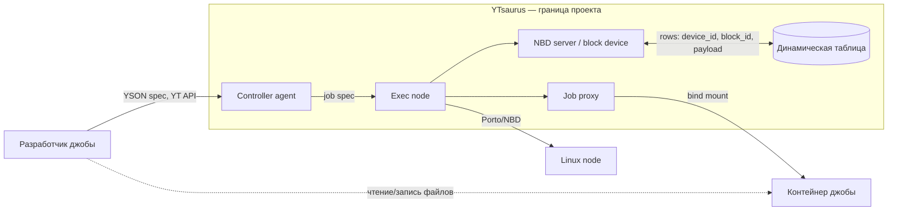
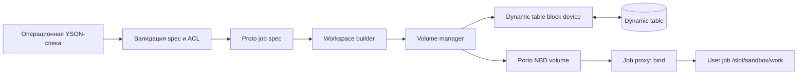
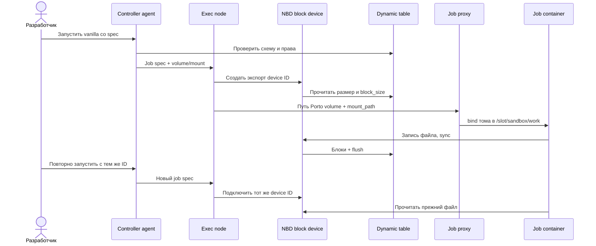

# КТ-2. Архитектурный комплект

**Владелец:** Наиль Зарипов. **Дата:** 24.11.2026. **Версия:** проект по коду `vk-25.3-nbd@c983b610de7`; перед публичным PR схемы сверяются с актуальным upstream. **Статус:** архитектура описана, независимый запуск ещё не подтверждён.

Легенда: сплошная стрелка — вызов/данные, пунктир — контроль или результат; прямоугольник — компонент, цилиндр — персистентные данные. Граница YTsaurus показана явно. Исходники схем — файлы `D-*.mmd` рядом с этим текстом. Для защиты подготовлены [D-01](D-01-context.svg), [D-02](D-02-components.svg), [D-03](D-03-deployment.svg), [D-04](D-04-success.svg) и [D-05](D-05-failure.svg) в SVG. Их содержимое надо сверить с финальным кодом до тега `cp2`.

## D-01. Контекст

Источник: [D-01-context.mmd](D-01-context.mmd). Пользователь управляет vanilla-операцией через YT API/CLI, система проверяет спеку и готовит NBD. Динамическая таблица YTsaurus хранит блоки и метаданные устройств. Linux/Porto/NBD — системная зависимость exec node. NFR-001/002/003 относятся к границе данных и доступа, NFR-007 — к сборке и запуску.



## D-02. Компоненты и границы доверия

Источник: [D-02-components.mmd](D-02-components.mmd). Controller agent проверяет наличие таблицы, схему и права пользователя, создаёт job spec. Exec node создаёт экспорт и Porto volume, job proxy передаёт bind в контейнер. Данные блочного устройства хранятся только в разрешённой таблице; содержимое файлов не попадает в логи. NFR-002/003/004/008.



## D-03. Развёртывание и состояние

Источник: [D-03-deployment.mmd](D-03-deployment.mmd). Преподаватель засчитывает YTsaurus и тестовый стенд как сервисную часть проекта. Для демонстрации нужны controller agent, exec node с NBD server, YT dynamic table и Linux/Porto. Образы и версии должны быть привязаны к SHA; секрет YT хранится вне репозитория. Сам факт наличия стенда не заменяет протокол воспроизводимого прогона, который ещё требуется приложить. NFR-001/004/005/007.

```mermaid
flowchart LR
  A[API/CLI client] --> C[Controller agent container]
  C --> E[Exec node container]
  subgraph Host[Linux host: Porto + NBD]
    E --> N[NBD server]
    E --> P[Porto job container]
    N --> D[/dev/nbdX]
    D --> P
  end
  N <--> T[(YT dynamic table)]
  CI[CI: build + tests] -.->|image digest / SHA| C
  CI -.->|image digest / SHA| E
```

**Ресурсы стенда:** предложены один exec node, один controller agent, тестовая таблица и два устройства по 1 GiB. Конкретные CPU/RAM, сетевые адреса, образ, порты и health check ещё фиксируются при подготовке независимого стенда. Никакие реальные токены в документации не хранятся.

## D-04. Основной сквозной путь

Источник: [D-04-success.mmd](D-04-success.mmd). Последовательность для US-001/002; при повторном запуске форматирование **не** повторяется.



## D-05. Отказ

Источник: [D-05-failure.mmd](D-05-failure.mmd). Таблица отсутствует или пользователь не имеет прав: операция/джоба получает ошибку, безопасного автоматического форматирования нет. При отказе во время I/O результат помечается ошибкой; восстановление данных проверяется отдельно. NFR-003/004/008.

```mermaid
sequenceDiagram
  actor User as Разработчик
  participant CA as Controller agent
  participant DT as Dynamic table
  participant EX as Exec node
  User->>CA: Отправить spec
  CA->>DT: CheckPermission + schema
  DT-->>CA: Отказ / неверная схема
  CA-->>User: Ошибка с table_path без payload
  Note over EX: Джоба не стартует; format не выполняется
```

## Модель данных

Динамическая таблица имеет строгую схему с уникальным составным ключом `(device_id: int64, block_id: int64)` и колонкой `block_payload: string`. `device_id` вычисляется из стабильной строки устройства; `block_id >= 0` обозначает блок данных, `-1` — размер устройства, `-2` — размер блока. Это состояние переживает завершение джобы. `volume_id` и `mount_path` живут в спеке; их связь проверяет controller agent. Размер и размер блока после форматирования менять нельзя без отдельной миграции. Для диагностики не логируется `block_payload`.

```mermaid
erDiagram
  DEVICE ||--o{ BLOCK : contains
  DEVICE { int64 device_id PK; int64 size "block -1"; int64 block_size "block -2" }
  BLOCK { int64 device_id PK; int64 block_id PK; string block_payload }
```

**Важная граница:** текущий код не реализует глобальную блокировку одного `device_id` между двумя активными джобами. Для MVP указано последовательное использование; для продуктивного многопользовательского запуска нужен отдельный механизм владения или согласованное ограничение в контракте.
