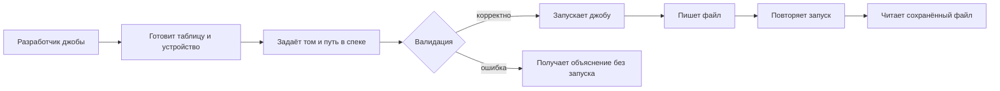

# КТ-1. User Story Map

**Владелец:** Наиль Зарипов. **Статус:** черновик на согласование. **Версия:** 24.11.2026.

Пользовательский путь: подготовить том → описать операцию → запустить джобу → работать с файлами → повторить запуск и проверить результат. Отдельная дорожка администратора: выдать права на backing table и диагностировать отказ. Линия MVP включает US-001–US-003; корневой режим US-004 проверяется на совместимость.

| Срез | Подготовить данные | Описать операцию | Работать с файлами | Повторить и проверить | Ошибка/поддержка |
| --- | --- | --- | --- | --- | --- |
| **MVP** | Создать таблицу и один раз форматировать тестовые устройства | US-001: один том; US-002: два независимых тома | US-001/002: читать и писать по `/slot/sandbox/...` | US-001: увидеть прежний файл; US-002: проверить изоляцию двух файловых систем | US-003: отклонить некорректную спеку до запуска |
| **Совместимость MVP** | Подготовить устройство для legacy-режима | US-004: `disk_request.nbd_disk.dynamic_table` | Проверить корневое размещение | Проверить прежний файл при повторном запуске | Сохранить старый data-node NBD сценарий |
| Позже | Автоматизировать provisioning без опасного повторного format | Согласовать upstream-форму `volumes`/mounts | Контролировать владельца устройства | Диагностировать сетевые отказы и восстанавливать | Метрики и runbook |
| Вне scope | Форматировать существующие пользовательские диски автоматически | Монтировать вне sandbox | Две активные джобы с одной ext4 | Совместная запись в одну ФС | UI notebook |

Передача ответственности: пользователь задаёт таблицу/спеку; controller agent проверяет контракт и права; exec node подготавливает устройство; job proxy показывает mount; пользователь видит файловый результат. Карточки и проверяемые результаты — в [stories.md](stories.md).
